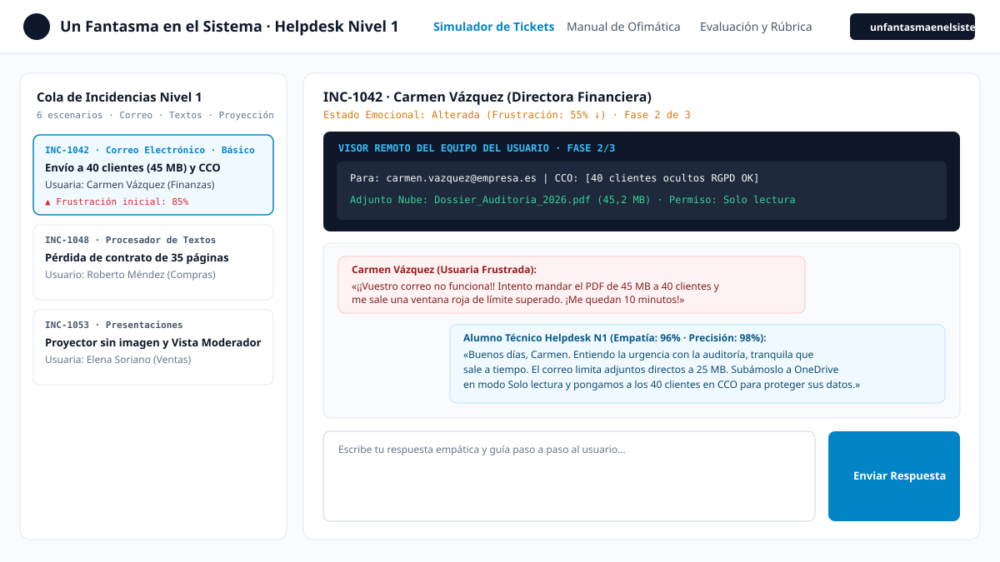
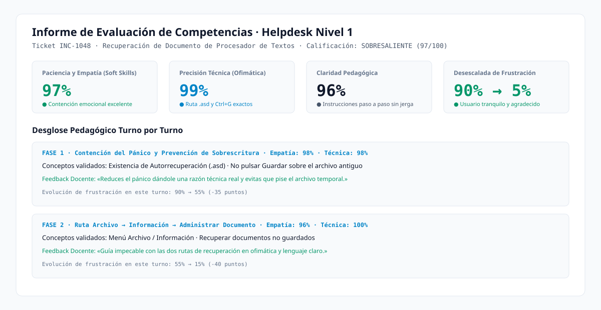
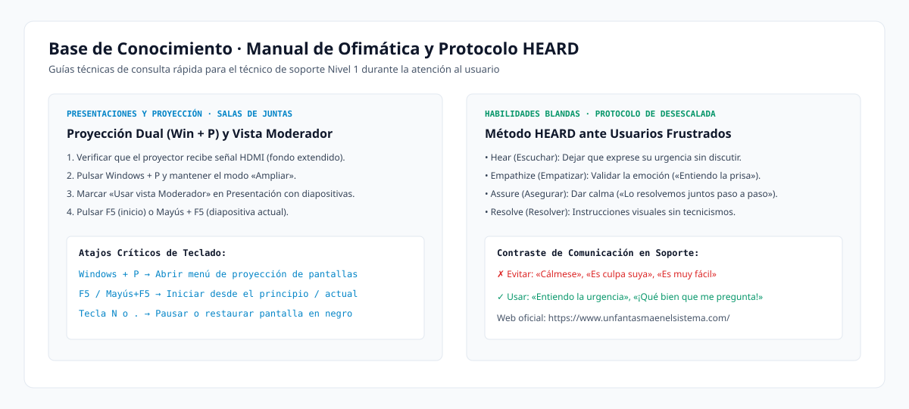

<div align="center">
  <a href="https://www.unfantasmaenelsistema.com/" target="_blank">
    
  </a>

  # Entrenamiento Helpdesk (Nivel 1) — Simulador de Asistencia a Usuarios

  **Simulador interactivo de soporte técnico Nivel 1 con «Personalidad de Usuario Frustrado» para entrenar habilidades blandas (*Soft Skills*: empatía, paciencia, claridad pedagógica) y conocimientos técnicos de Ofimática (Correo Electrónico, Procesador de Textos y Presentaciones).**

  🌐 **Proyecto educativo de [Un Fantasma en el Sistema](https://www.unfantasmaenelsistema.com/)**
</div>

---

## 📋 Descripción del Proyecto

En el trabajo real de un técnico de **Helpdesk / Service Desk de Nivel 1**, saber la respuesta técnica es solo la mitad del éxito: la otra mitad consiste en **contener la frustración del usuario**, escuchar sin ponerse a la defensiva, explicar cada paso con un lenguaje claro sin jerga innecesaria y educar para prevenir futuras incidencias.

Esta aplicación web adopta la **Personalidad de Usuario Frustrado** en 6 escenarios reales de oficina. El alumno actúa como técnico de soporte guiando al usuario a través de 3 fases progresivas (**1. Contención y Diagnóstico → 2. Resolución Guiada Paso a Paso → 3. Verificación y Prevención**) mientras observa en tiempo real el **Visor Remoto del Equipo del Usuario** y el **Termómetro de Frustración**.

Al finalizar cada ticket, el simulador genera un **Informe de Evaluación con Rúbrica Docente** que mide:
1. **Paciencia y Empatía (Habilidades Blandas)** (`0% – 100%`)
2. **Precisión Técnica en Ofimática (Hard Skills)** (`0% – 100%`)
3. **Claridad Pedagógica y Comunicación Paso a Paso** (`0% – 100%`)
4. **Índice de Desescalada Emocional** (evolución de la frustración turno a turno)

---

## 🖼️ Capturas de Pantalla de la Aplicación

### 1. Consola Principal de Simulación y Visor Remoto del Equipo del Usuario


### 2. Informe Final de Evaluación y Rúbrica Turno por Turno


### 3. Base de Conocimiento de Ofimática y Protocolo HEARD


---

## 🎯 Escenarios de Entrenamiento Incluidos (6 Tickets Nivel 1)

| Código | Categoría | Usuario Frustrado | Incidencia Simulada | Competencias Técnicas Evaluadas |
| :--- | :--- | :--- | :--- | :--- |
| **`INC-1042`** | **Correo Electrónico** | Carmen Vázquez *(Directora Financiera)* | Bloqueo al adjuntar PDF de 45 MB para 40 clientes externos a 10 min de cerrar auditoría. | Límite de 25 MB en correo, enlace en la nube en modo *Solo lectura*, uso obligatorio de **CCO (Copia Oculta)** por RGPD y verificación en *Elementos enviados*. |
| **`INC-1048`** | **Procesador de Textos** | Roberto Méndez *(Jefe de Compras)* | Pérdida de contrato de 35 páginas tras cierre inesperado sin haber guardado. | Frenar sobrescritura del archivo antiguo, ruta `Archivo > Información > Administrar documento`, `Recuperar documentos no guardados (.asd)`, botón *Restaurar* y atajo **`Ctrl + G`**. |
| **`INC-1053`** | **Presentaciones** | Elena Soriano *(Directora Comercial)* | El proyector de la sala de juntas solo muestra el fondo de escritorio vacío y teme que se vean sus notas privadas. | Atajo **`Windows + P`** (diferencia entre *Duplicar* y *Ampliar*), activar **Vista Moderador**, lanzar con **`F5`** / **`Mayús + F5`** e intercambiar monitores. |
| **`INC-1059`** | **Correo Electrónico** | Julián Ortega *(Coordinador Logístico)* | No entran correos desde las 9:00 con tres camiones esperando albaranes en el muelle. | Desactivar modo **Trabajar sin conexión** en la barra de estado, rescatar mensajes de **Correo no deseado (Spam)** marcando remitente seguro y filtro *Tiene archivos adjuntos*. |
| **`INC-1064`** | **Procesador de Textos** | Lucía Pardo *(Secretaria de Dirección)* | Al añadir dos líneas en la página 2 se descuadran las 40 páginas de la memoria anual y cambia la letra en la imprenta. | Mostrar marcas de formato (**`¶` / `Ctrl + Mayús + 8`**), sustituir `Enter` repetidos por **Salto de página (`Ctrl + Enter`)** y exportar a **PDF** con fuentes incrustadas. |
| **`INC-1071`** | **Presentaciones** | Marcos Vidal *(Formador de Prevención)* | La pantalla se pone completamente negra a mitad de clase al rozar el teclado y el vídeo no suena por el proyector. | Cortinilla negra con la **tecla `N` o `.`**, conmutar salida de audio de Windows a **HDMI / Proyector** e **incrustar vídeo** dentro del `.pptx` en lugar de vincularlo. |

---

## 🛠️ Modos de Práctica para el Alumno

* **Modo Respuesta Libre (Redacción Propia):** El estudiante redacta su propia respuesta como en un chat real de soporte. El motor pedagógico analiza en tiempo real marcadores de empatía, ausencia de reproches, conectores de claridad paso a paso y presencia de los conceptos técnicos de ofimática requeridos en cada fase.
* **Modo Laboratorio Guiado (Opciones Tácticas):** Permite comparar 3 enfoques de respuesta en cada turno (*Empática + Precisa*, *Técnica pero Fría/Cortante* y *Amable pero Técnicamente Errónea*), o cargar una plantilla en el editor para personalizarla antes de enviarla.
* **Exportación de Evidencias para el Profesor:** Al terminar uno o varios tickets, el alumno puede exportar su **Informe Completo de Evaluación en Markdown (`.md`) o JSON**, o imprimirlo directamente en PDF.

---

## 🚀 Instalación Local y Despliegue en GitHub Pages

La aplicación está configurada con rutas relativas (`base: './'` en `vite.config.ts`) y funciona al **100% en alojamiento estático (GitHub Pages)** sin requerir servidores externos ni claves de API para ejecutar las simulaciones.

### 1. Ejecución en entorno local

```bash
# Clonar el repositorio
git clone https://github.com/TU_USUARIO/TU_REPOSITORIO.git
cd TU_REPOSITORIO

# Instalar dependencias
npm install

# Iniciar servidor de desarrollo (puerto 3000)
npm run dev
```

### 2. Compilar para producción

```bash
npm run build
```
Esto generará la carpeta estática `dist/` lista para alojar en cualquier servidor o en GitHub Pages.

### 3. Despliegue automático en GitHub Pages (Recomendado)

El proyecto ya incluye el flujo de trabajo oficial en `.github/workflows/deploy.yml`:

1. Sube este código a un repositorio de GitHub en la rama `main`.
2. En tu repositorio de GitHub, entra en **Settings → Pages**.
3. En la sección **Build and deployment → Source**, selecciona **GitHub Actions**.
4. Al hacer cualquier `git push` a `main` (o lanzándolo manualmente desde la pestaña **Actions**), GitHub compilará y publicará automáticamente la aplicación en `https://TU_USUARIO.github.io/TU_REPOSITORIO/`.

---

## 👨‍🏫 Autoría y Créditos

Desarrollado para **[Un Fantasma en el Sistema](https://www.unfantasmaenelsistema.com/)**.  
Recurso educativo abierto para Formación Profesional (Sistemas Microinformáticos y Redes — SMR, Administración de Sistemas y módulos de Ofimática y Atención al Usuario).
