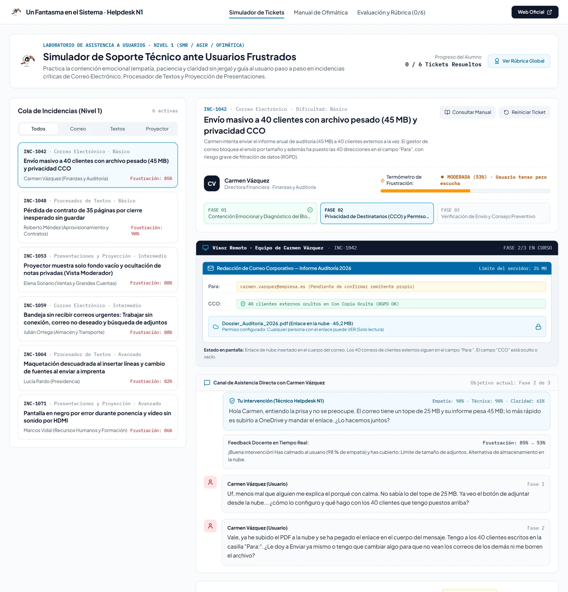
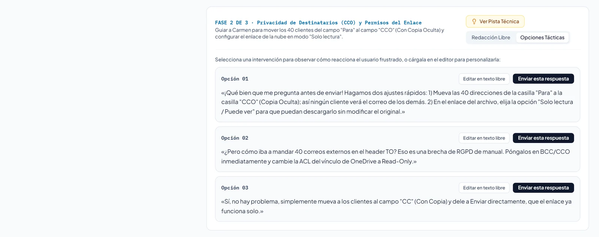
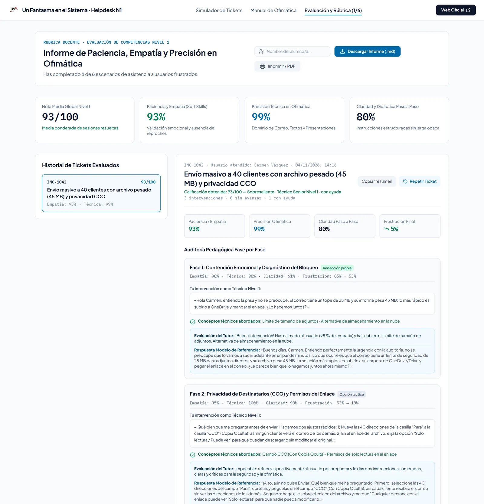
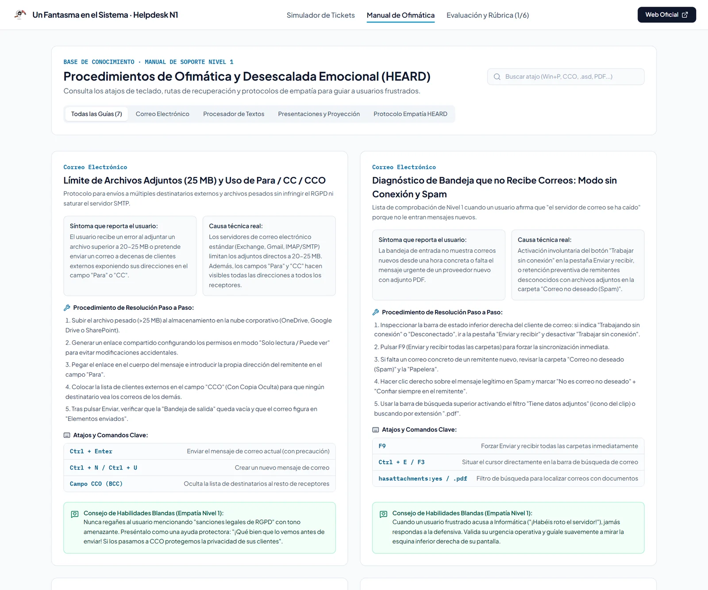

<p align="center">
  <a href="https://www.unfantasmaenelsistema.com"></a>
</p>

<h1 align="center">Entrenamiento Helpdesk Nivel 1</h1>

<p align="center">
  <b>Simulador de soporte técnico ante usuarios frustrados: empatía, claridad y ofimática</b><br>
  6 tickets reales de oficina · Correo, Word y presentaciones · Termómetro de frustración · Rúbrica fase a fase · Informe para el profesor
</p>

<p align="center">
  <a href="https://unfantasmaenelsistema.github.io/Entrenamiento-Helpdesk-Nivel1/"><b>▶ Abrir el simulador</b></a> ·
  <a href="#qué-hace">Qué hace</a> ·
  <a href="#los-6-tickets">Los 6 tickets</a> ·
  <a href="#cómo-se-evalúa">Cómo se evalúa</a> ·
  <a href="#desarrollo">Desarrollo</a> ·
  <a href="https://www.unfantasmaenelsistema.com">unfantasmaenelsistema.com</a> ·
  <a href="LICENSE">MIT</a>
</p>

<p align="center">
  
  
  
  
</p>

<p align="center">
  
</p>

En un servicio de soporte de Nivel 1, saber la solución técnica es solo la mitad del trabajo: la otra mitad es atender a una persona que está nerviosa, no culparla, explicarle cada paso sin jerga y dejarle un consejo para que no vuelva a pasar. Este simulador pone al alumno al otro lado de seis incidencias reales de oficina con usuarios que llegan muy alterados, y evalúa a la vez el trato y la precisión técnica.

> [!NOTE]
> Todo funciona en el navegador, sin servidor ni claves de API. Las respuestas, el nombre del alumno y los informes se guardan solo en el `localStorage` de ese navegador.

## Qué hace

- **Cola de 6 tickets** de correo electrónico, procesador de textos y presentaciones, cada uno en **3 fases**: contención y diagnóstico, resolución guiada y verificación con consejo preventivo.
- **Visor remoto** del equipo del usuario, que cambia según lo que le has pedido hacer, y **termómetro de frustración** que sube o baja con cada respuesta.
- **Redacción libre**: escribes tu respuesta como en un chat de soporte y se corrige al momento (conceptos técnicos de la fase, empatía, claridad).
- **Opciones tácticas**: compara tres respuestas posibles por fase (empática y precisa, correcta pero fría, amable pero equivocada) y mira cómo reacciona el usuario.
- **Pista** bajo demanda con los conceptos que se evalúan en la fase.
- **Informe de evaluación** por ticket y global, con la auditoría fase a fase, descarga en Markdown, copia del resumen e impresión a PDF.
- **Manual de ofimática** con la causa, la solución y los atajos de cada incidencia.

<p align="center">
  
</p>

## Los 6 tickets

| Ticket | Área | Usuario | Incidencia | Lo que hay que saber |
| :-- | :-- | :-- | :-- | :-- |
| `INC-1042` | Correo | Carmen, directora financiera | No puede enviar un PDF de 45 MB a 40 clientes externos, y los tiene a todos en «Para». | Límite de adjuntos (20-25 MB), enlace en la nube en solo lectura, **CCO** (con copia oculta) por protección de datos, comprobar en *Elementos enviados*. |
| `INC-1048` | Word | Roberto, jefe de compras | Se cerró el procesador de textos con un contrato de 35 páginas sin guardar. | No sobrescribir, *Archivo > Información > Administrar documento*, *Recuperar documentos no guardados*, **Ctrl + G**, Autoguardado (en OneDrive/SharePoint) y Autorrecuperación. |
| `INC-1053` | Presentaciones | Elena, directora comercial | El proyector solo muestra el fondo de escritorio y teme que se vean sus notas. | **Windows + P** (*Duplicar* / *Extender*), **Vista Moderador**, **F5** y **Mayús + F5**, *Mostrar configuración > Intercambiar Vista Moderador y Presentación de diapositivas*. |
| `INC-1059` | Correo | Julián, coordinador logístico | No le entran correos y hay tres camiones esperando albaranes. | *Trabajar sin conexión*, carpeta *Correo no deseado* y *No es correo no deseado*, filtro **Tiene datos adjuntos**, estado *Conectado*. |
| `INC-1064` | Word | Lucía, secretaria de dirección | Al añadir dos líneas se descuadran 40 páginas y en la imprenta cambia la letra. | **Mostrar todo (¶)**, cambiar los Intro repetidos por **salto de página (Ctrl + Enter)**, exportar a **PDF** para conservar fuentes y diseño. |
| `INC-1071` | Presentaciones | Marcos, formador | La pantalla se queda en negro a mitad de clase y el vídeo no suena por el proyector. | Tecla **N** o **punto** (pantalla en negro), salida de audio **HDMI** desde el icono del altavoz, **incrustar** el vídeo en lugar de vincularlo. |

<p align="center">
  
</p>

## Cómo se evalúa

- **Precisión técnica**: cada fase tiene dos o tres conceptos (por ejemplo, «CCO» y «solo lectura»). Para avanzar hay que mencionar al menos la mitad. El corrector busca **expresiones completas y específicas** («CCO», «Ctrl + Enter», «Mostrar todo»), no palabras sueltas: una respuesta amable pero genérica no hace avanzar en ninguna fase.
- **Empatía**: suma por expresiones que validan al usuario («entiendo», «no se preocupe», «vamos a…») y resta mucho por reproches («es obvio», «debería haber guardado», «deje de quejarse») o por escribir en mayúsculas.
- **Claridad**: pasos ordenados (primero, luego, 1., 2.…), referencias concretas a la interfaz (pestaña, botón, menú) y una extensión razonable.
- **Nota del ticket**: 40 % empatía, 40 % técnica y 20 % claridad, con la media de **todas** las intervenciones, también las que no hicieron avanzar.
- **Intervenciones con ayuda**: las opciones tácticas y las respuestas copiadas o retocadas de la respuesta modelo se marcan como «con ayuda» en el informe, y la nota del ticket lo indica.

> [!IMPORTANT]
> Es un corrector por conceptos: no entiende el sentido de las frases (una negación como «no use CCO» también cuenta como mencionar CCO). Sirve para practicar y para que el profesor vea cómo responde cada alumno; la nota no sustituye a la revisión del profesor.

<p align="center">
  
</p>

## Desarrollo

Requisitos: Node.js 20 o superior.

```bash
git clone https://github.com/unfantasmaenelsistema/Entrenamiento-Helpdesk-Nivel1.git
cd Entrenamiento-Helpdesk-Nivel1
npm ci
npm run dev      # http://localhost:3000
npm test         # 45 tests del corrector y de los escenarios
npm run lint     # comprobación de tipos
npm run build    # versión estática en dist/
```

Cada `push` a `main` pasa por el workflow [`deploy.yml`](.github/workflows/deploy.yml) (tipos, tests y build) y se publica en GitHub Pages. Los pull requests ejecutan las mismas comprobaciones sin publicar.

```text
src/
├── data/scenarios.ts             Los 6 tickets: fases, conceptos, respuestas modelo y opciones tácticas
├── data/knowledgeBase.ts         Manual de ofimática
├── utils/evaluationEngine.ts     Corrector (conceptos, empatía, claridad, ayuda, nota)
├── utils/evaluationEngine.test.ts
├── App.tsx                       Cola de tickets, conversación y modos de respuesta
└── components/                   Visor remoto, informe y manual
```

Para añadir un ticket basta con un objeto más en `scenarios.ts`. Los tests comprueban que la respuesta modelo de cada fase cubre todos sus conceptos y que una respuesta genérica no avanza.

## Novedades de la versión 2

- **La nota contaba solo los aciertos**: las respuestas que no hacían avanzar desaparecían del informe. Ahora cuentan todas, y el informe muestra cuántas no avanzaron.
- **El corrector buscaba trozos de palabra**: «mb» aprobaba con «también» o «nombre», y conceptos como «para», «ver» o «pestaña» se cumplían con casi cualquier frase. Ahora busca expresiones completas y específicas.
- **Pegar la respuesta modelo daba la nota máxima**: ahora esas intervenciones y las opciones tácticas cuentan como «con ayuda».
- El usuario respondía «frío» con una frustración que bajaba como si hubiera sido cálido (había dos umbrales distintos). Ahora hay uno solo.
- Terminología de Windows y Office en español: *Extender* (no «Ampliar») en Windows + P, *Con copia oculta* (no «Copia de Carbón Oculta»), *Tiene datos adjuntos* y `hasattachments:yes` en Outlook, *Mostrar configuración > Intercambiar Vista Moderador y Presentación de diapositivas* en PowerPoint, y Autoguardado aclarando que solo funciona con OneDrive o SharePoint.
- Fuera los restos de AI Studio (sección «Guía GitHub Pages», dependencias de Gemini y Express) y las capturas dibujadas en SVG; se arregla la instalación con npm, la pista empieza oculta, las fechas del informe incluyen el día y el diseño ya no se desborda en el móvil.

## Créditos y licencia

Desarrollado para **[Un Fantasma en el Sistema](https://www.unfantasmaenelsistema.com)**. Recurso educativo abierto para Formación Profesional (Sistemas Microinformáticos y Redes, módulos de ofimática y atención al usuario). Distribuido bajo licencia [MIT](LICENSE).
